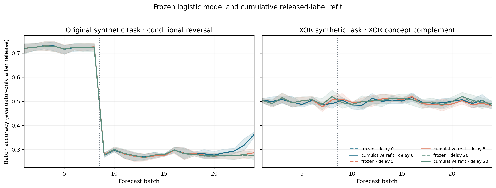
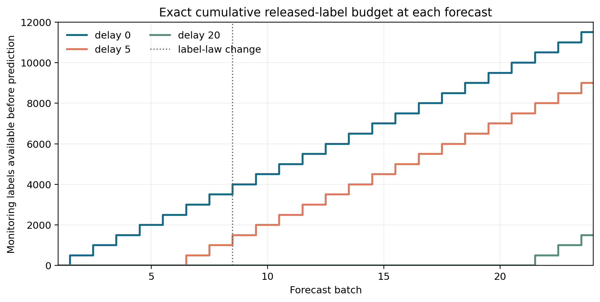

# Released-label adaptation in controlled synthetic streams

**Ahmed Bilal (23I-2581) and Umar Behram (23I-2604)**  
Data Analysis and Visualization · Phase 3 supplementary experiment

**Status:** Outcome-informed exploratory add-on, protocol locked before its development and final runs.

## Question and scope

This small experiment asks whether cumulative refitting on labels after their scheduled release changes batch accuracy under two selected synthetic conditional changes: C3 (label-probability reversal with unchanged inputs) and X3 (XOR concept complement with unchanged inputs). Selection was informed by the earlier study's conditional-only failures and the extension's XOR task. The experiment is not external validation and is kept separate from the frozen-model results.

The final run used 5 fresh seeds per condition, 3 delays, and 24 batches of 500 rows. It created 10 feature streams, 30 delay streams, 1440 online method-batch records, 720,000 exact prediction/truth joins and 360,000 scheduled label rows.

## Locked comparison

Both arms use LogisticRegression(C=1, max_iter=500), training-only StandardScaler and the same initial 4,000 training rows. The frozen arm never updates. The adaptation arm refits on those training rows plus all unique monitoring labels available strictly before the next batch prediction. Calibration and reference partitions are not used for adaptation. No current or future label is passed to prediction; each batch's two prediction arrays are persisted before broker release, including delay zero.

At forecast batch `t` and delay `d`, the exact available monitoring-label count is `500 × min(24, max(0, t−d−1))`. At batch 24, delays 0, 5 and 20 make 11,500, 9,000 and 1,500 labels available before scoring; after drainage each releases the same 12,000 labels by clock 24+d. The frozen model is a zero-label update baseline, so gains versus it represent access-and-update effects. The only adaptive procedure is evaluated at exact, logged release budgets; no adaptive-method leaderboard is made.

The primary metric is paired-seed accuracy change over post-onset batches 9–24, with late post-onset batches 17–24 and pre-onset batches 1–8 shown separately. Macro F1 is secondary. Bootstrap intervals resample complete 30-seed vectors, never batches or delays.

## Results

| Condition | Delay | Regime | Adapted minus frozen accuracy, mean [seed-bootstrap 95% interval] | Seeds |
|---|---:|---|---:|---:|
| conditional reversal | 0 | late post | +0.0226 [+0.0183, +0.0269] | 5 |
| conditional reversal | 0 | post onset | -0.0011 [-0.0036, +0.0014] | 5 |
| conditional reversal | 0 | pre onset | +0.0001 [-0.0014, +0.0014] | 5 |
| conditional reversal | 5 | late post | +0.0029 [+0.0016, +0.0040] | 5 |
| conditional reversal | 5 | post onset | -0.0015 [-0.0032, +0.0002] | 5 |
| conditional reversal | 5 | pre onset | +0.0003 [-0.0005, +0.0010] | 5 |
| conditional reversal | 20 | late post | +0.0004 [-0.0001, +0.0011] | 5 |
| conditional reversal | 20 | post onset | +0.0000 [+0.0000, +0.0000] | 5 |
| conditional reversal | 20 | pre onset | +0.0000 [+0.0000, +0.0000] | 5 |
| XOR concept complement | 0 | late post | -0.0015 [-0.0092, +0.0050] | 5 |
| XOR concept complement | 0 | post onset | -0.0012 [-0.0089, +0.0073] | 5 |
| XOR concept complement | 0 | pre onset | -0.0055 [-0.0135, +0.0021] | 5 |
| XOR concept complement | 5 | late post | -0.0086 [-0.0146, -0.0038] | 5 |
| XOR concept complement | 5 | post onset | +0.0043 [-0.0007, +0.0093] | 5 |
| XOR concept complement | 5 | pre onset | -0.0030 [-0.0066, +0.0005] | 5 |
| XOR concept complement | 20 | late post | +0.0008 [-0.0039, +0.0056] | 5 |
| XOR concept complement | 20 | post onset | +0.0000 [+0.0000, +0.0000] | 5 |
| XOR concept complement | 20 | pre onset | +0.0000 [+0.0000, +0.0000] | 5 |

The table reports the measured paired difference; intervals crossing zero do not establish a directional effect. C3 and X3 remain generator-specific examples. Their different results do not prove that adaptation generally repairs delayed monitoring or confidence estimation.

## Evidence separation and validation

`online_batches.csv` and per-batch prediction archives contain no outcome fields. `released_labels.csv` carries IDs and labels with availability clocks; `evaluator_truth/` is retrospective. The evaluator checked exact availability budgets before each fit, that no fitting label had an availability clock at or after its forecast, same-clock persistence ordering, identical release IDs across delays, exact prediction/truth joins, and drainage without new input. All metrics are evaluator-only. This is not a security boundary or human study.

## Limitations

This add-on studies one cumulative refit rule and one linear logistic model on two selected synthetic conditional-change cases. It does not add recalibration, confidence intervals, harm probabilities, or detector claims. The frozen comparison intentionally uses zero monitoring labels for fitting; only the availability schedules are shared. Cumulative retraining repeatedly reuses older released labels, so compute exposure differs from incremental training even though each adaptive run receives the same unique released IDs. No external data, natural onset labels, human participants, or analyst-benefit claims are present.

**Reproduction:** from the workspace root, run `scripts/run_phase3_adaptation.py --mode final --out results/phase3/adaptation_reproduction`, then `scripts/evaluate_phase3_adaptation.py --run results/phase3/adaptation_reproduction` and `scripts/report_phase3_adaptation.py --run results/phase3/adaptation_reproduction --out reports/phase3/adaptation_reproduction`. Use fresh, unused output directories. Exact Python package versions are in `environment.json`.
