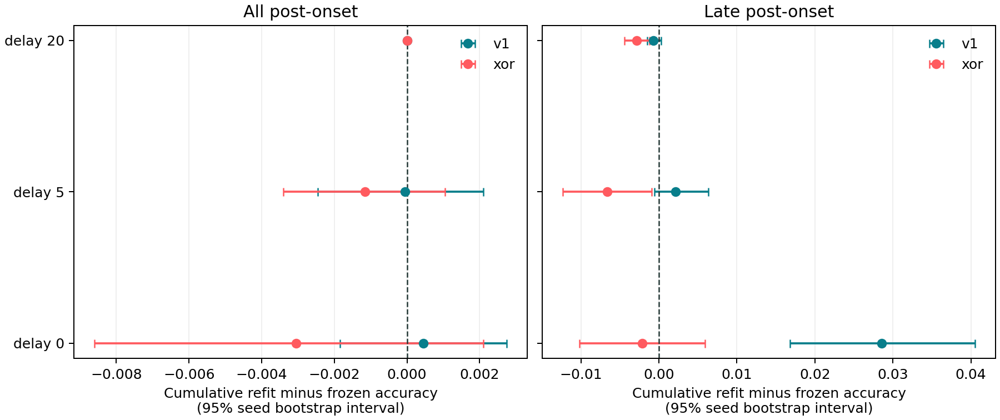

# Fresh-seed replication of delayed-label adaptation

**Ahmed Bilal (23I-2581) and Umar Behram (23I-2604)**  
Data Analysis and Visualization · Phase 3 supplementary experiment

**Protocol status:** Outcome-informed replication locked before its fresh seed run; selected C3/X3 cases were chosen after the earlier pilot. This is not external validation.

## Purpose

The original adaptation pilot had 30 seeds per task. Its zero-delay C3 late-post gain was larger than its all-post estimate, and the XOR effects were small. This replication tests how those patterns vary over 5 fresh seeds per task using the same two synthetic conditions and cumulative logistic update rule. It does not introduce an updater or tune thresholds.

## Protocol and validation

The frozen and cumulative-refit arms start from the same 4,000 training rows and training-only scaler. The adaptive fit uses only unique monitoring labels released strictly before the next prediction. Same-clock predictions are flushed before release, including delay zero. At forecast batch 24, the preprediction label budgets are 11,500, 9,000 and 1,500 for delays 0, 5 and 20; for delay 20 none of those labels are post-onset. The queues drain without new inputs.

Validation passed 1,440 prediction/truth batch checks, 720 scheduled release rows, exact budgets, no future-label fit access, identical release IDs across delays and complete queue drainage. Online rows omit outcomes; evaluator rows are retrospective. Paired uncertainty resamples complete seeds (2,000 replicates).

## Paired accuracy differences



| Task / condition | Delay | Regime | Adapted minus frozen accuracy [95% seed interval] | Seeds |
|---|---:|---|---:|---:|
| v1_synthetic/C3 | 0 | late_post | +0.02855 [+0.01680, +0.04055] | 5 |
| v1_synthetic/C3 | 0 | post | +0.00045 [-0.00185, +0.00275] | 5 |
| v1_synthetic/C3 | 0 | pre | +0.00180 [+0.00015, +0.00400] | 5 |
| v1_synthetic/C3 | 5 | late_post | +0.00215 [-0.00056, +0.00635] | 5 |
| v1_synthetic/C3 | 5 | post | -0.00005 [-0.00245, +0.00210] | 5 |
| v1_synthetic/C3 | 5 | pre | -0.00015 [-0.00065, +0.00035] | 5 |
| v1_synthetic/C3 | 20 | late_post | -0.00070 [-0.00150, +0.00030] | 5 |
| v1_synthetic/C3 | 20 | post | +0.00000 [+0.00000, +0.00000] | 5 |
| v1_synthetic/C3 | 20 | pre | +0.00000 [+0.00000, +0.00000] | 5 |
| xor_synthetic/X3 | 0 | late_post | -0.00215 [-0.01020, +0.00590] | 5 |
| xor_synthetic/X3 | 0 | post | -0.00305 [-0.00860, +0.00210] | 5 |
| xor_synthetic/X3 | 0 | pre | +0.00060 [-0.00490, +0.00550] | 5 |
| xor_synthetic/X3 | 5 | late_post | -0.00660 [-0.01230, -0.00090] | 5 |
| xor_synthetic/X3 | 5 | post | -0.00115 [-0.00340, +0.00105] | 5 |
| xor_synthetic/X3 | 5 | pre | -0.00050 [-0.00165, +0.00065] | 5 |
| xor_synthetic/X3 | 20 | late_post | -0.00285 [-0.00445, -0.00125] | 5 |
| xor_synthetic/X3 | 20 | post | +0.00000 [+0.00000, +0.00000] | 5 |
| xor_synthetic/X3 | 20 | pre | +0.00000 [+0.00000, +0.00000] | 5 |

Intervals crossing zero do not establish a directional effect. The intervention cases are selected synthetic examples, not a broad test of adaptation.

## Interpretation limits

This replication changes only the fresh seed count. It uses one linear logistic classifier, one cumulative refit procedure and two outcome-informed synthetic conditional-change cases. The frozen comparator uses zero monitoring labels for fitting, so this is an access-and-update contrast, not an adaptive-method leaderboard at equal consumed-label budgets. The design does not claim calibration repair, calibrated harm probabilities, external validity, safety or analyst benefit. A possible reason a linear updater may struggle with XOR is its inability to represent the interaction; that mechanism is a hypothesis unless directly tested against a nonlinear updater.

## Reproduction

From the workspace root, use fresh paths:

```powershell
powershell -NoProfile -ExecutionPolicy Bypass `
  -File .\scripts\reproduce_phase3_adaptation_replication.ps1 `
  -RunDir results/phase3/adaptation_seed_replication_reproduction `
  -ReportDir reports/phase3/adaptation_seed_replication_reproduction
```

Exact environment and hashes are recorded in the run. Prior final results and prepared archives are unchanged.
