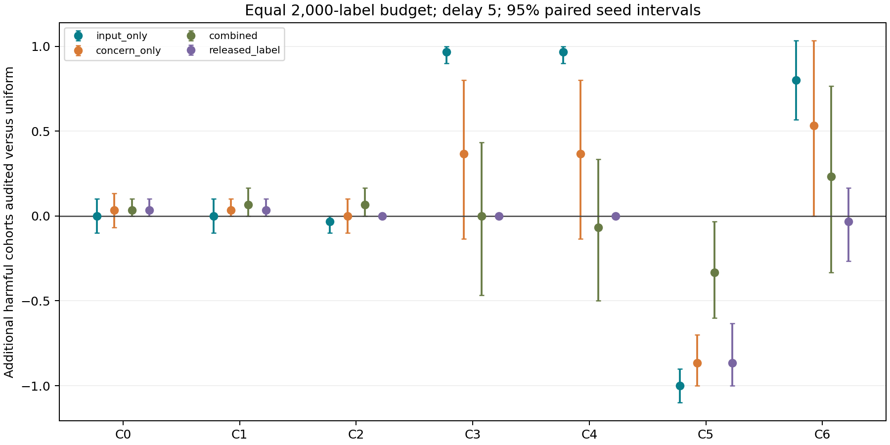
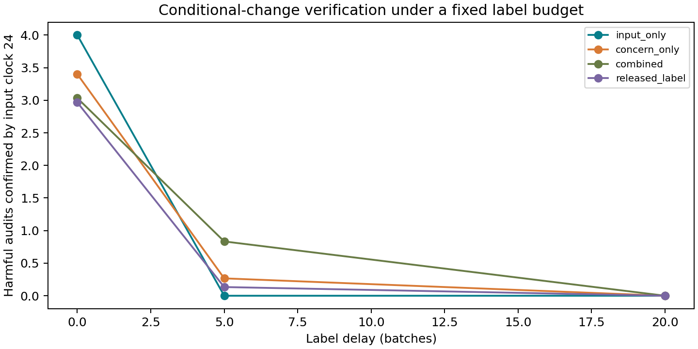
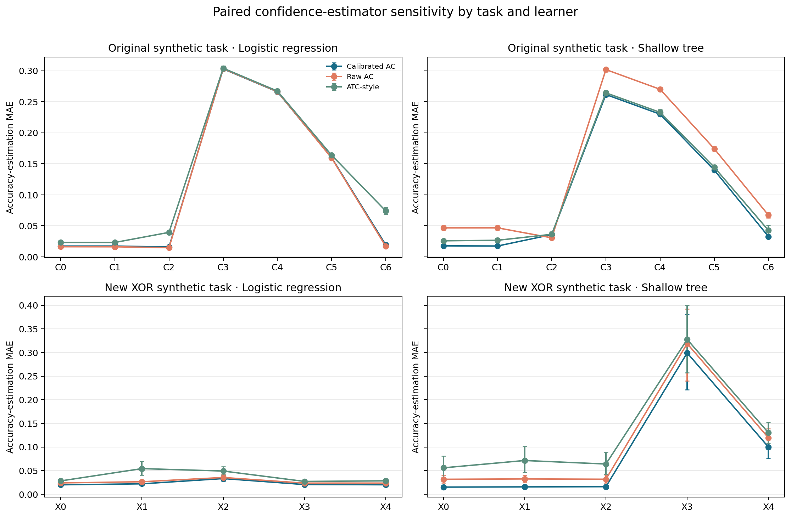
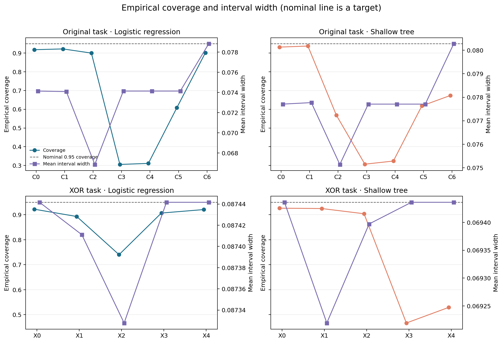
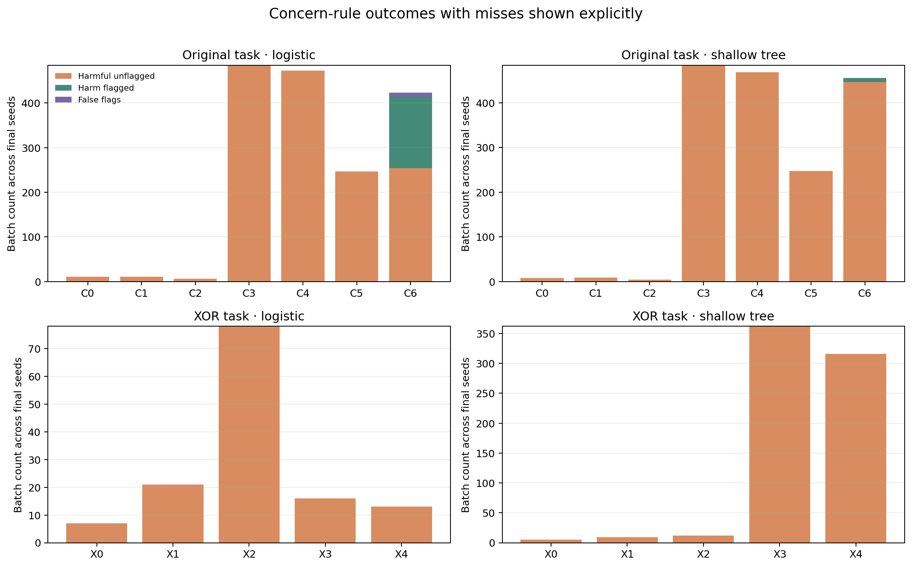
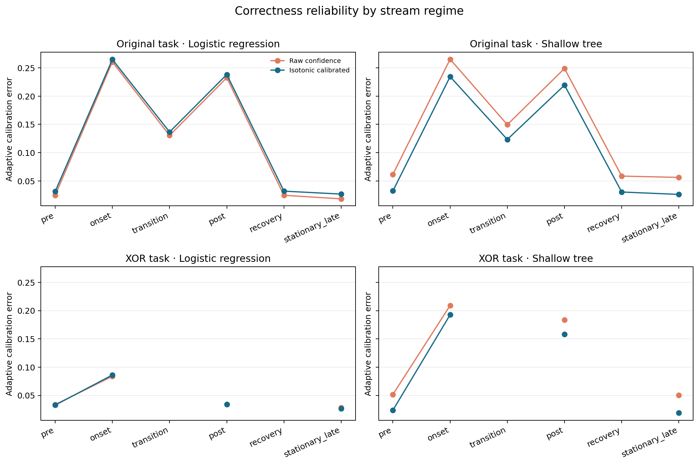
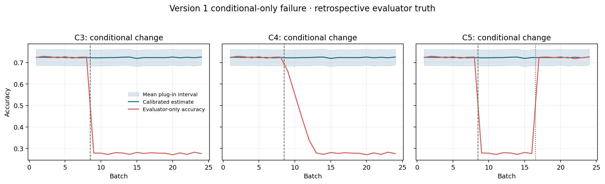
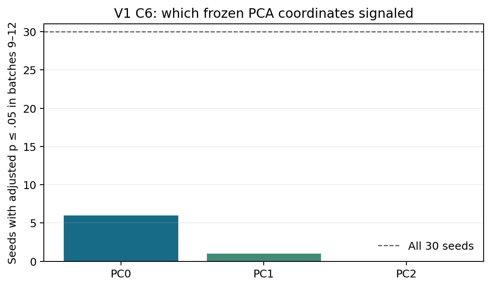
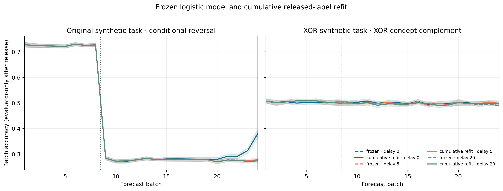
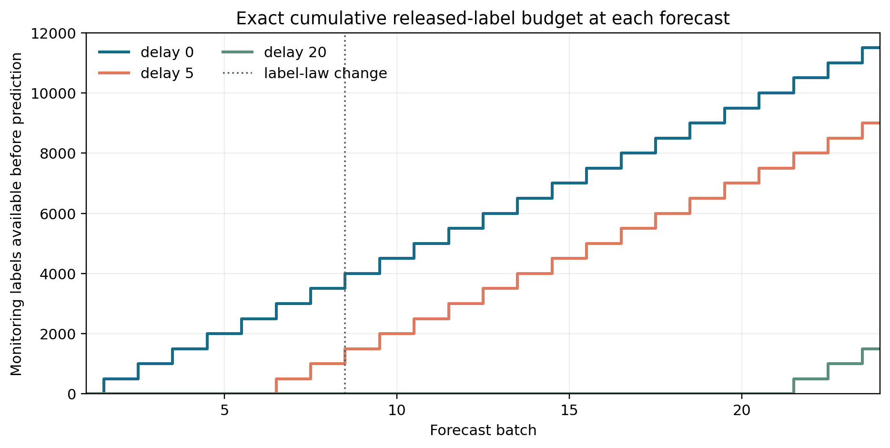

# IDM-Viz: consolidated implementation and experimental evaluation

## Research basis and scope

The submitted Phase 2 DOCX is the authoritative methodological basis. No instructor feedback was received. The implementation connects input-distribution alarms, descriptive feature/cluster evidence, source-calibrated current-cohort accuracy estimates, delayed-label verification and coordinated visualization. Its concern score is a plug-in proxy for current-cohort harm relative to historical accuracy; horizon h=0. It is not a validated future-loss forecast. The proposed analyst study, causal discovery and neural anchor remain deferred. The frozen PCA anchor is an explicit substitution. No human benefit is established.

The new label-audit comparison is outcome-informed. All existing evidence remains unchanged. Audit actions purchase verification; they do not refit classifiers or increase their accuracy. It evaluates usefulness of automated audit allocation, not analyst decision quality.

## Equal-budget audit protocol

Five policies are compared: fixed uniform, input evidence, calibrated concern, conjunction of development-percentile input/concern, and prior released-label evidence. Thresholds use only development seeds 90001-90005. Final seeds 100-129 were already studied, so this is an exploratory extension rather than an untouched confirmatory test. Budget is exactly two or four 500-label cohorts per 24-batch stream. Delays are 0, 5 and 20. Selected predictions precede same-clock release, including zero delay. Remaining quota is filled at the tail, explicitly logged. The released-label comparator makes an initial scheduled probe and may use only selected labels released strictly before the current clock.

Equal budget does not imply equal scheduling. Tail filling can favor persistent late drift and hurt recurrence; it is part of the policy, not evidence that an input detector detected a conditional change. The comparison is batch-audit allocation, not episode-level deployment utility. Costs are label counts, not monetary or human costs. Harm targets are model-specific realised accuracy drops greater than 0.05 against the frozen historical reference. Reference uncertainty is omitted.

## Paired audit results

The table includes every condition at the predeclared example delay 5/budget 4. Intervals use 2,000 paired seed bootstrap replicates. These many exploratory comparisons have no familywise significance guarantee; effect sizes are the principal evidence. All delays and budgets are included in the machine-readable results.

| condition   | policy         |   mean |   lower |   upper |
|:------------|:---------------|-------:|--------:|--------:|
| C0          | input_only     |  0.000 |  -0.100 |   0.100 |
| C0          | concern_only   |  0.033 |  -0.067 |   0.133 |
| C0          | combined       |  0.033 |   0.000 |   0.100 |
| C0          | released_label |  0.033 |   0.000 |   0.100 |
| C1          | input_only     |  0.000 |  -0.100 |   0.100 |
| C1          | concern_only   |  0.033 |   0.000 |   0.100 |
| C1          | combined       |  0.067 |   0.000 |   0.167 |
| C1          | released_label |  0.033 |   0.000 |   0.100 |
| C2          | input_only     | -0.033 |  -0.100 |   0.000 |
| C2          | concern_only   |  0.000 |  -0.100 |   0.100 |
| C2          | combined       |  0.067 |   0.000 |   0.167 |
| C2          | released_label |  0.000 |   0.000 |   0.000 |
| C3          | input_only     |  0.967 |   0.900 |   1.000 |
| C3          | concern_only   |  0.367 |  -0.133 |   0.800 |
| C3          | combined       |  0.000 |  -0.467 |   0.433 |
| C3          | released_label |  0.000 |   0.000 |   0.000 |
| C4          | input_only     |  0.967 |   0.900 |   1.000 |
| C4          | concern_only   |  0.367 |  -0.134 |   0.800 |
| C4          | combined       | -0.067 |  -0.500 |   0.333 |
| C4          | released_label |  0.000 |   0.000 |   0.000 |
| C5          | input_only     | -1.000 |  -1.100 |  -0.900 |
| C5          | concern_only   | -0.867 |  -1.000 |  -0.700 |
| C5          | combined       | -0.333 |  -0.600 |  -0.033 |
| C5          | released_label | -0.867 |  -1.000 |  -0.633 |
| C6          | input_only     |  0.800 |   0.567 |   1.033 |
| C6          | concern_only   |  0.533 |   0.000 |   1.033 |
| C6          | combined       |  0.233 |  -0.333 |   0.767 |
| C6          | released_label | -0.033 |  -0.267 |   0.167 |

## Feature-localization evidence

| condition   |   precision_at_1 |   recall_at_3 |   feature_flag_recall |
|:------------|-----------------:|--------------:|----------------------:|
| C1          |            1.000 |         1.000 |                 1.000 |
| C2          |            0.988 |         0.994 |                 0.973 |

These values are aggregated over batches with known changed marginals in C1/C2. They are not causal attribution. C6 changes dependence with unchanged marginals; C3-C5 alter labels without a known changed input marginal. Their feature-localization metric is undefined, not zero or successful. Frozen clusters are descriptive regions, not validated causal explanations.

## External calibration transfer failure

The preserved UCI 224 cohort evaluation uses batch 1 split into 267 training, 89 calibration and 89 reference rows; batches 2-10 remain whole monitoring cohorts. Mean cohort accuracy is 0.432, macro-F1 0.290, calibrated estimated accuracy 0.976, MAE 0.545, approximate interval coverage 0/9 and input alarms 9/9. This is one external dataset and not nine independent replications. Class composition and sensor conditions change together. Small source calibration, normal-approximation intervals, a different correctness mapping and absent simulated release timing limit comparability with the synthetic study. Historical batch-1 class-proportion metadata has a denominator defect; monitoring outcomes are unaffected, but that metadata must not be used as a probability distribution. The class-mix sensitivity is descriptive and outcome-informed.

## Research comparison and interpretation

Average Thresholded Confidence predicts target accuracy using thresholded model confidence. Garg et al. show that unlabeled accuracy estimation requires assumptions about distribution shift; comparison to their published numeric scores is not fair on our different generators and learners. Our ATC-style baseline is therefore a within-study comparator. Ovadia et al. benchmark uncertainty under dataset shift, supporting evaluation of calibration transfer rather than an assumption that source calibration persists. Neither paper establishes IDM-Viz's superiority or analyst usefulness. Sources: https://arxiv.org/abs/2201.04234 and https://proceedings.neurips.cc/paper/2019/hash/8558cb408c1d76621371888657d2eb1d-Abstract.html .

## Original and model/task extension evidence

The following preserved study text supplies the classifier setup, baseline and component-ablation evidence. It predates the audit extension; its scope statements refer to that study version. Timings and historical receipts must not be presented as newly repeated tests.

## Model/task study

# Phase 3: Research Implementation and Experimental Evaluation

**Ahmed Bilal (23I-2581) and Umar Behram (23I-2604)**  
Department of AI and Data Science, FAST-NUCES Islamabad  
Data Analysis and Visualization

**Protocol status:** Outcome-informed extension; final evidence generated from the locked extension protocol.

## Summary

Version 2 adds a fixed shallow tree comparison on the original controlled task and a new XOR synthetic task. The final run has 360 feature streams and 17,280 model-batch records. It evaluates both learners with their own correctness calibrator, ATC-style threshold and historical reference. The XOR task is synthetic and is not external-domain validation.

On stationary XOR, tree minus logistic accuracy was 0.2168 (seed-bootstrap 95% interval 0.1567 to 0.2751). On v1 stationary data the paired accuracy difference was -0.0323 (-0.0343 to -0.0301).

Exact extension check passed for 210 v1-task streams, 1680 cached arrays and 25,210,080 array values. V1 logistic predictions, confidence arrays and original condition records are preserved as the matched comparison; no v1 seed or outcome is replaced.

## What the extension tests

The shallow tree is fixed at Gini criterion, depth 6 and minimum leaf size 25. Logistic regression retains `C=1`, `max_iter=500` and a 0.5 class cutoff. Both models use training-only scaling and independent isotonic calibrators fitted on the same correctness-calibration rows. No hyperparameter search is performed.

The new XOR task uses eight independent standard-normal features and the noisy concept `1{(X0 > 0) XOR (X1 > 0)}` with 10% baseline label noise. Its locked interventions are stationary, irrelevant mean shift, relevant mean shift, concept complement and increased label noise. The last two preserve inputs and alter only the label law. Synthetic event times are known from construction; no onset labels are fabricated for a natural dataset.

The local ELEC2 candidate was rejected: the raw ARFF’s `date` is non-monotone, 528 `(date, period)` pairs repeat, and 11 date values have 96 rows instead of 48. The date/period fields therefore do not uniquely reconstruct row chronology. The processed parquet also fails to read. OpenML’s local metadata reports its license field as `Public`; this report does not turn that label into a specific permissive license. The source record and original study are listed at the end.

## Overall results

| Task | Model | Calibrated AC MAE, mean [seed-bootstrap 95% interval] | Coverage | Mean interval width |
|---|---|---:|---:|---:|
| Original synthetic task | Logistic | 0.114189 [0.113086, 0.115365] | 0.695238 [0.675397, 0.712103] | 0.073760 [0.073481, 0.074024] |
| Original synthetic task | Shallow tree | 0.105031 [0.103582, 0.106560] | 0.622817 [0.605754, 0.639484] | 0.077718 [0.077465, 0.077968] |
| XOR synthetic task | Logistic | 0.023147 [0.021421, 0.024964] | 0.876667 [0.852771, 0.900833] | 0.087413 [0.087353, 0.087474] |
| XOR synthetic task | Shallow tree | 0.089146 [0.069485, 0.110378] | 0.750278 [0.705826, 0.798618] | 0.069385 [0.063868, 0.074830] |

For context, the earlier study reported calibrated AC MAE 0.114189 versus raw AC MAE 0.113387, and calibrated coverage 0.695238. Its retained baseline tables give the corresponding seed rows and denominators. These cohorts are not pooled with the two new synthetic tasks.

Per-condition summaries, complete seed rows, paired seed contrasts, pooled harm counts, undefined metrics and bootstrap intervals are provided in the CSV files. The tree’s model-specific historical reference changes its realised-harm label; differences in harm counts alone do not rank the models. Matched-cohort accuracy and estimation error are reported separately.

## Failure analysis

In v1 C3-C5, the calibrated confidence channel averaged 0.723 while evaluator-only accuracy averaged 0.488; 1,205 batches met the v1 realised-harm rule and the calibrated concern rule flagged 0. This is measured. Those conditions reuse identical input arrays while changing the conditional label law, so the input detector has no distributional input evidence by construction. The model receives familiar inputs and retains its source confidence even when its predictions become wrong. The frozen source calibrator cannot infer a label-law reversal from confidence alone.

Version 1 calibrated AC MAE (0.114189) exceeded raw AC MAE (0.113387) by 0.000802; calibrated interval coverage was 0.695. The plausible explanation that an isotonic map learned source reliability but did not transfer to changed regimes is consistent with the conditional-only results, but it is not a unique causal explanation. V2 adds pre/onset/post/recovery reliability summaries and reports calibration error and Brier score by model and regime.

For C6, v1 matched the dependence onset in 8/30 seeds with full KS/PCA and 4/30 with original-feature KS. Individual frozen PCA-coordinate adjusted-p detections in the onset window were: PC0 6/30, PC1 1/30, PC2 0/30. PCA therefore supplied some additional task-specific marginal evidence, but did not solve the missed-event problem; the PCA basis is descriptive and fixed from training.

Version 2 reports interval width alongside empirical coverage and concern TP/FP/FN/TN counts for each task, model, condition and regime. A no-flag outcome is not a safety verdict. The plug-in Poisson-binomial interval and concern score are not calibrated harm probabilities or arbitrary-shift coverage guarantees.

At the end of 24 input batches, delayed verification leaves 0 batches unresolved for delay 0, 5 for delay 5, and 20 for delay 20; after drainage all 24 are verified at ages 0, 5 and 20 batches respectively. Delay changes evidence availability and age, not the frozen estimator’s accuracy.

## Figures

**Paired model sensitivity:** estimation error by task, condition and learner.

**Interval behavior:** empirical coverage and width; the nominal line is a target.

**Concern-rule outcomes:** harmful batches left unflagged are shown directly.

**Reliability:** calibrated and raw scores across stream regimes.

**V1 failure analysis:** conditional-only shift with evaluator-only truth.

**V1 dependence analysis:** adjusted-p detections by frozen PCA coordinate.

## Version comparison and research questions

- **Established beyond v1:** model sensitivity on matched original-task observations; an independently seeded synthetic task with an axis-aligned nonlinear boundary; model-specific calibration, harm targets, intervals and paired uncertainty; failure reliability split by task, model and regime.
- **Contradicts a universal model claim:** neither learner dominates every task/regime on accuracy, estimation error, coverage and harm flags. Interpret comparisons only within matched cohorts and state the model-specific reference target.
- **Unchanged:** v1’s logistic method, original condition evidence, thresholds, delays and negative findings remain intact. V2 does not retrofit v1 outcomes or claim a natural-domain replication.
- **RQ1:** current-batch realised deterioration is evaluated in controlled synthetic streams; future forecasting and certified population harm remain untested.
- **RQ2:** feature evidence remains descriptive marginal ranking; causal attribution and cluster localization accuracy remain unanswered.
- **RQ3:** analyst benefit remains unanswered; there is no human-subject evaluation.
- **RQ4:** robustness evidence now spans two synthetic task families, not external or natural-domain validation.

## Limitations and provenance

The evidence uses one linear probabilistic learner and one fixed shallow tree on two synthetic families. It does not include external-domain validation, neural autoencoders, causal discovery, online adaptation, selective-label analysis or a human study. Calibration is frozen, confidence-based, and dependent on the source law. Interval width and empirical coverage are descriptive. Bootstrap intervals resample complete seed vectors; batches, delay copies, models and ablations are not treated as independent datasets. Version 2 hypotheses were informed by observed v1 outcomes, so the extension is not described as an untouched preregistration.

The submitted Phase 2 DOCX remains the methodological basis; the older TeX is only supporting material, and no instructor feedback was received. The original two-page implementation brief was consulted and preserved. The existing offline replay is a prototype, contains retrospective release information and is not a security boundary or human-evaluation result.

**Sources consulted for the rejected ELEC2 candidate:** [OpenML dataset 151](https://www.openml.org/d/151); Gama, Medas, Castillo and Rodrigues, *Learning with Drift Detection* (2004), [primary paper](https://sweet.ua.pt/gladys/Papers/GamaMedasCastilloRodriguesSBIA04.pdf). The published task results are not treated as comparable benchmarks.

## Reproduction and artifact semantics

**Independent reproduction:** a clean run matched 741 CSVs (6,768,744 cells) and 1,140 compressed arrays (6,660 arrays; 95,554,560 values) exactly. Timing columns and protocol metadata were excluded from scientific equality checks.
The first comparator attempt differed only in bootstrap summaries of wall-clock `input_seconds`. That engineering timing was removed from uncertainty summaries, and both saved runs were reevaluated; no inputs, seeds, predictions, model settings or scientific thresholds changed.

Use `Reproduce.md` for the package contents and run separation; the project workspace guide `docs/phase3/23I-2581_23I-2604_Phase3_Reproduction.md` gives the exact full-rerun commands. The final run has a protocol lock and exact environment versions. `predictions/` contain persisted online scores; `released_verification.csv` contains scheduled label results; `evaluator_truth/` and `evaluator_batches.csv` are retrospective. Historical source documents and run archives are preserved.

## Selected adaptation study

# Released-label adaptation in controlled synthetic streams

**Ahmed Bilal (23I-2581) and Umar Behram (23I-2604)**  
Data Analysis and Visualization · Phase 3 supplementary experiment

**Status:** Outcome-informed exploratory add-on, protocol locked before its development and final runs.

## Question and scope

This small experiment asks whether cumulative refitting on labels after their scheduled release changes batch accuracy under two selected synthetic conditional changes: C3 (label-probability reversal with unchanged inputs) and X3 (XOR concept complement with unchanged inputs). Selection was informed by the earlier study's conditional-only failures and the extension's XOR task. The experiment is not external validation and is kept separate from the frozen-model results.

This final evidence uses 30 seeds per condition, 3 delays, and 24 batches of 500 rows. It created 60 feature streams, 180 delay streams, 8640 online method-batch records, 4,320,000 exact prediction/truth joins and 2,160,000 scheduled label rows.

## Locked comparison

Both arms use LogisticRegression(C=1, max_iter=500), training-only StandardScaler and the same initial 4,000 training rows. The frozen arm never updates. The adaptation arm refits on those training rows plus all unique monitoring labels available strictly before the next batch prediction. Calibration and reference partitions are not used for adaptation. No current or future label is passed to prediction; each batch's two prediction arrays are persisted before broker release, including delay zero.

At forecast batch `t` and delay `d`, the exact available monitoring-label count is `500 × min(24, max(0, t−d−1))`. At batch 24, delays 0, 5 and 20 make 11,500, 9,000 and 1,500 labels available before scoring; after drainage each releases the same 12,000 labels by clock 24+d. The frozen model is a zero-label update baseline, so gains versus it represent access-and-update effects. The only adaptive procedure is evaluated at exact, logged release budgets; no adaptive-method leaderboard is made.

The primary metric is paired-seed accuracy change over post-onset batches 9–24, with late post-onset batches 17–24 and pre-onset batches 1–8 shown separately. Macro F1 is secondary. Bootstrap intervals resample complete 30-seed vectors, never batches or delays. Shaded plot intervals use the same complete-seed-vector resampling.

## Results

| Condition | Delay | Regime | Adapted minus frozen accuracy, mean [seed-bootstrap 95% interval] | Seeds |
|---|---:|---|---:|---:|
| conditional reversal | 0 | late post | +0.0239 [+0.0197, +0.0287] | 30 |
| conditional reversal | 0 | post onset | +0.0002 [-0.0007, +0.0011] | 30 |
| conditional reversal | 0 | pre onset | +0.0002 [-0.0004, +0.0008] | 30 |
| conditional reversal | 5 | late post | +0.0003 [-0.0005, +0.0013] | 30 |
| conditional reversal | 5 | post onset | -0.0001 [-0.0009, +0.0007] | 30 |
| conditional reversal | 5 | pre onset | +0.0001 [-0.0003, +0.0004] | 30 |
| conditional reversal | 20 | late post | -0.0001 [-0.0005, +0.0002] | 30 |
| conditional reversal | 20 | post onset | +0.0000 [+0.0000, +0.0000] | 30 |
| conditional reversal | 20 | pre onset | +0.0000 [+0.0000, +0.0000] | 30 |
| XOR concept complement | 0 | late post | +0.0034 [-0.0020, +0.0091] | 30 |
| XOR concept complement | 0 | post onset | +0.0037 [-0.0017, +0.0096] | 30 |
| XOR concept complement | 0 | pre onset | -0.0026 [-0.0052, -0.0001] | 30 |
| XOR concept complement | 5 | late post | +0.0027 [-0.0016, +0.0075] | 30 |
| XOR concept complement | 5 | post onset | +0.0014 [-0.0028, +0.0058] | 30 |
| XOR concept complement | 5 | pre onset | -0.0000 [-0.0010, +0.0010] | 30 |
| XOR concept complement | 20 | late post | +0.0018 [+0.0002, +0.0035] | 30 |
| XOR concept complement | 20 | post onset | +0.0000 [+0.0000, +0.0000] | 30 |
| XOR concept complement | 20 | pre onset | +0.0000 [+0.0000, +0.0000] | 30 |

The table reports the measured paired difference; intervals crossing zero do not establish a directional effect. C3 and X3 remain generator-specific examples. Their different results do not prove that adaptation generally repairs delayed monitoring or confidence estimation.

In C3 at delay 0, late post-onset accuracy rose from 0.2755 frozen to 0.2995 adapted (paired difference +0.0239); however, across all post-onset batches the paired change was only +0.0002 [-0.0007, +0.0011]. At delays 5 and 20, the late-post differences were +0.0003 and -0.0001. For X3, late-post adapted accuracy stayed near 0.50 and differences ranged from +0.0018 to +0.0034; there was no meaningful overall post-onset improvement. This is limited recovery in one condition, not a general adaptation result.

At the batch-24 prediction, delays 0, 5 and 20 had 11,500, 9,000 and 1,500 labels available, of which 7,500, 5,000 and 0 came from post-onset batches. Thus delay 20 had no post-onset labels available to learn from by the final input prediction. The cumulative model also retains all pre-onset training examples. A plausible explanation for the weak X3 response is that a linear logistic boundary cannot represent the XOR interaction; the experiment did not directly test alternative nonlinear update mechanisms.

## Evidence separation and validation

An independent clean run matched 8 CSVs (17,682,084 cells) and 4,440 compressed arrays (21,840 arrays; 18,720,000 values) exactly. Timing and run-metadata fields were excluded.

`online_batches.csv` and per-batch prediction archives contain no outcome fields. `released_labels.csv` carries IDs and labels with availability clocks; `evaluator_truth/` is retrospective. The evaluator checked exact availability budgets before each fit, that no fitting label had an availability clock at or after its forecast, same-clock persistence ordering, identical release IDs across delays, exact prediction/truth joins, and drainage without new input. All metrics are evaluator-only. This is not a security boundary or human study.

## Limitations

This add-on studies one cumulative refit rule and one linear logistic model on two selected synthetic conditional-change cases. It does not add confidence calibration, prediction intervals, harm probabilities, or detector claims. The frozen comparison intentionally uses zero monitoring labels for fitting; only the availability schedules are shared. Cumulative retraining repeatedly reuses older released labels, so compute exposure differs from incremental training even though each adaptive run receives the same unique released IDs. No external data, natural onset labels, human participants, or analyst-benefit claims are present.

**Reproduction:** from the workspace root, run `powershell -NoProfile -ExecutionPolicy Bypass -File .\scripts\reproduce_phase3_adaptation.ps1 -RunDir results/phase3/adaptation_new_reproduction -ReportDir reports/phase3/adaptation_new_reproduction`. Use fresh, unused output directories. The wrapper evaluates the saved labels, checks exact equality with this final run, and renders the report. Exact Python package versions are in `environment.json`.

## Validation and unresolved claims

The audit extension tests equal quotas, prefix decisions unaffected by future scores, strict zero-delay release ordering and absence of unavailable feedback at long delay. All budget rows are checked. No full fresh reproduction of the earlier classifier experiments is claimed by this report. The long 1,500-seed-per-task robustness study is still a separate running job and has no final findings here. A larger number of seeds cannot repair calibration transfer, prove future forecasting, establish causal explanations, or replace a participant study.

The evidence view labels unresolved estimates and current-cohort scope. Existing as-of release logic is retained; revised wording does not certify current calibration. Inspect the generated pages and dashboard before final submission. Original source documents and submitted archive remain preserved. New results and manuscript are prepared research improvements, not uploaded submissions.
