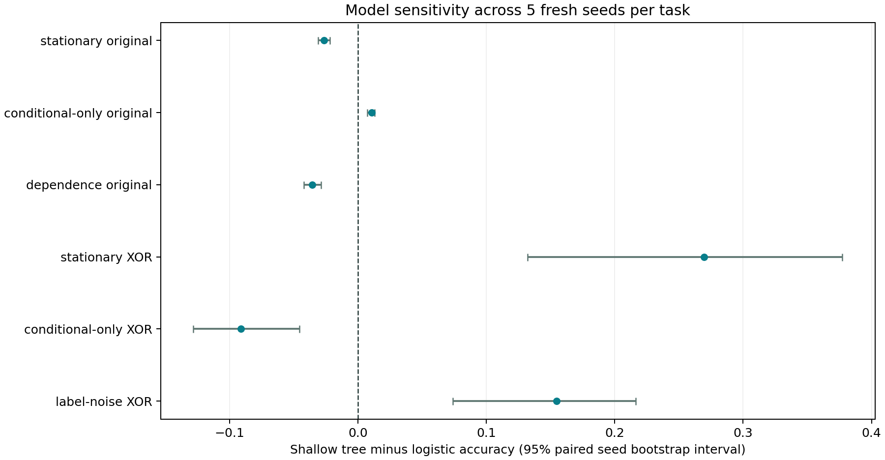
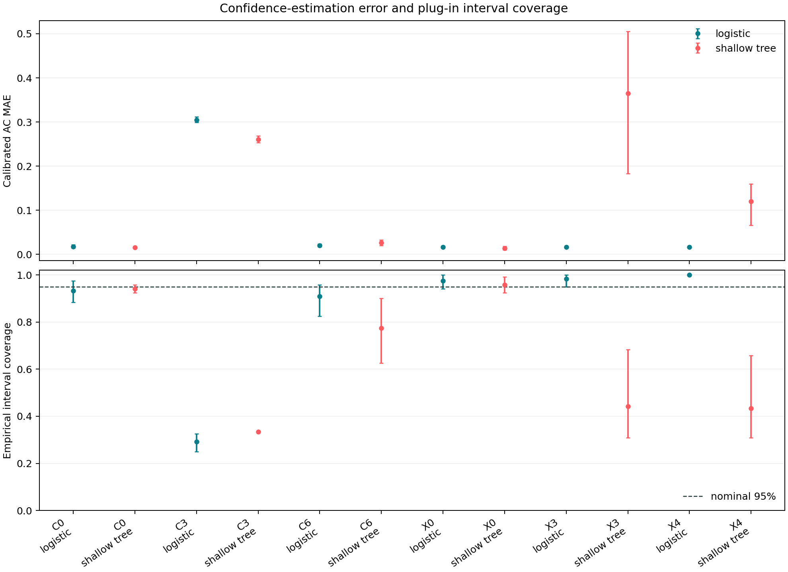

# Large-seed robustness and remaining failure modes

**Ahmed Bilal (23I-2581) and Umar Behram (23I-2604)**  
Data Analysis and Visualization · Phase 3 supplementary experiment

**Protocol status:** Outcome-informed robustness replication. It reuses the frozen synthetic task laws and analysis settings; it is not external validation and not a preregistration preceding the earlier studies.

## Why this experiment was run

The main remaining sampling weakness was that model sensitivity and the XOR task had 30 final seeds each. This run adds 5 fresh seeds per task (3,000 task-seed replications total), holding the generators, partitions, models, calibrators, thresholds, conditions and batch sizes fixed. It tests seed sensitivity; it does not widen the data domains.

## Design and integrity

The original synthetic task has seven conditions and XOR has five. Each has 12,000 monitoring rows in 24 batches of 500. Logistic regression and the fixed depth-6 tree share each stream; their own historical references define their own realised-harm targets. Thresholds or seeds were not selected from results. The online table contains no labels, accuracy, F1 or harm; evaluator metrics are stored separately and joined after each batch score is written. This scale run stores aggregate batch outputs and deterministically regenerated inputs rather than per-instance caches.

The run covers 2,880 online batch records and 2,880 evaluator batch records. Exact strict harm boundaries, unique row keys, model pairing, common input alarms, calibrated-estimate identity and finite scores passed validation. Paired uncertainty uses 2,000 bootstrap replicates over complete seeds.

## Model sensitivity



Positive accuracy differences favor the tree on the matched cohort. Intervals are seed-bootstrap intervals; they do not treat individual batches as independent. Refer to `paired_model_bootstrap.csv` for all conditions and metrics.

## Estimation and interval behavior



Coverage is shown against the nominal 95% reference and with seed uncertainty; widths are in the result tables. Coverage shortfall is not repaired by lower alert burden. Concern counts and unflagged harmful batches are reported in the per-seed summaries.

## Input alarms and conditional-only failures

`input_detection_summary.csv` reports per-condition seed denominators and alarm frequencies. For synthetic input-shift conditions C1/C2/C6 and X1/X2, onset matching is defined only over batches 9–12. Conditional-only conditions C3/C4 and X3/X4 keep the input stream unchanged by construction, so an input-only detector has no input-distribution signal for their label changes. A lack of alarm in these cases does not mean low model impact or safety.

The earlier C3–C5 misses and v1 calibration results remain part of the evidence; this fresh-seed run can show how consistently those failures recur under the same generators. It cannot identify a universal cause. A plausible explanation remains source-law confidence transfer under conditional change; the experiments measure the failure pattern, not a unique causal mechanism.

## What this adds and what it does not

It narrows Monte Carlo uncertainty for two existing synthetic task families and tests whether the 30-seed model/calibration/alert findings persist over fresh streams. It does not add a natural data source, new learner, alternative adaptive mechanism, human evaluation, causal explanation or external-domain evidence. The XOR task is another controlled synthetic task. RQ3 analyst benefit remains unanswered.

## Reproduction

From the workspace root, use fresh output paths:

```powershell
& C:/Users/hp/anaconda3/python.exe scripts/run_phase3_large_seed.py --mode final --out results/phase3/large_seed_robustness_reproduction
& C:/Users/hp/anaconda3/python.exe scripts/evaluate_phase3_large_seed.py --run results/phase3/large_seed_robustness_reproduction
& C:/Users/hp/anaconda3/python.exe scripts/report_phase3_large_seed.py --run results/phase3/large_seed_robustness_reproduction --out reports/phase3/large_seed_robustness_reproduction
```

Exact package versions and source hashes are stored in the run directory. Existing v1/v2/adaptation outputs and prepared archives remain unchanged.
