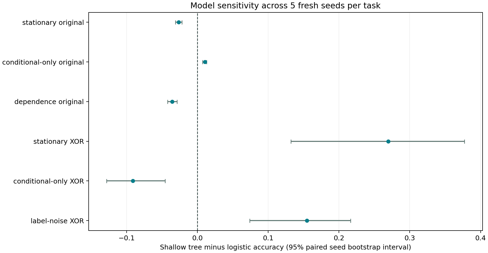
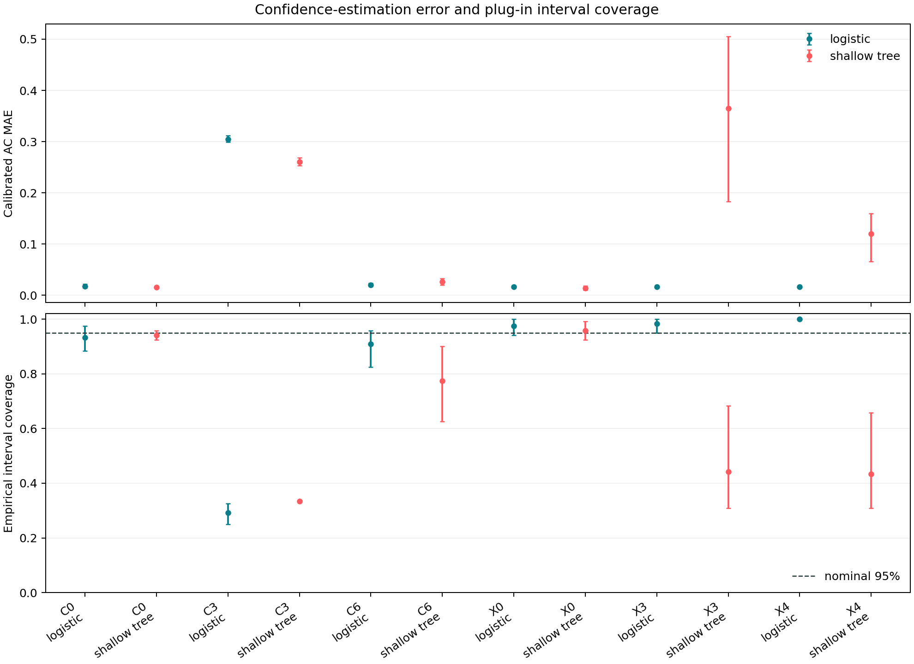

# Large-seed robustness and remaining failure modes

**Ahmed Bilal (23I-2581) and Umar Behram (23I-2604)**  
Data Analysis and Visualization · Phase 3 supplementary experiment

**Protocol status:** Outcome-informed robustness replication. It reuses the frozen synthetic task laws and analysis settings; it is not external validation and not a preregistration preceding the earlier studies.

## Why this experiment was run

The main remaining sampling weakness was that model sensitivity and the XOR task had 30 final seeds each. This run adds 5 fresh seeds per task (10 task-seed replications total), holding the generators, partitions, models, calibrators, thresholds, conditions and batch sizes fixed. It tests seed sensitivity; it does not widen the data domains.

## Design and integrity

The original synthetic task has seven conditions and XOR has five. Each has 12,000 monitoring rows in 24 batches of 500. Logistic regression and the fixed depth-6 tree share each stream; their own historical references define their own realised-harm targets. Thresholds or seeds were not selected from results. The online table contains no labels, accuracy, F1 or harm; evaluator metrics are stored separately and joined after each batch score is written. This scale run stores aggregate batch outputs and deterministically regenerated inputs rather than per-instance caches.

The run covers 2,880 online batch records and 2,880 evaluator batch records. Exact strict harm boundaries, unique row keys, model pairing, common input alarms, calibrated-estimate identity and finite scores passed validation. Paired uncertainty uses 2,000 bootstrap replicates over complete seeds.

## Model sensitivity



Positive accuracy differences favor the tree on the matched cohort. Intervals are seed-bootstrap intervals; they do not treat individual batches as independent. Refer to `paired_model_bootstrap.csv` for all conditions and metrics.

| Cohort | Model | Accuracy [95% seed interval] | Calibrated MAE [95% seed interval] | Coverage [95% seed interval] | Calibrated width [95% seed interval] |
|---|---|---:|---:|---:|---:|
| stationary original | logistic | 0.7207 [0.7189, 0.7227] | 0.0179 [0.0150, 0.0220] | 0.9333 [0.8833, 0.9750] | 0.0740 [0.0732, 0.0749] |
| stationary original | shallow tree | 0.6941 [0.6901, 0.6984] | 0.0157 [0.0145, 0.0165] | 0.9417 [0.9250, 0.9583] | 0.0775 [0.0769, 0.0781] |
| conditional-only original | logistic | 0.4255 [0.4243, 0.4269] | 0.3048 [0.2988, 0.3121] | 0.2917 [0.2500, 0.3250] | 0.0740 [0.0732, 0.0749] |
| conditional-only original | shallow tree | 0.4363 [0.4323, 0.4396] | 0.2606 [0.2536, 0.2686] | 0.3333 [0.3333, 0.3333] | 0.0775 [0.0769, 0.0781] |
| dependence original | logistic | 0.6728 [0.6702, 0.6756] | 0.0205 [0.0173, 0.0242] | 0.9083 [0.8250, 0.9583] | 0.0787 [0.0781, 0.0794] |
| dependence original | shallow tree | 0.6372 [0.6308, 0.6433] | 0.0266 [0.0199, 0.0331] | 0.7750 [0.6250, 0.9000] | 0.0802 [0.0797, 0.0809] |
| stationary XOR | logistic | 0.4985 [0.4969, 0.5004] | 0.0170 [0.0153, 0.0187] | 0.9750 [0.9417, 1.0000] | 0.0874 [0.0873, 0.0875] |
| stationary XOR | shallow tree | 0.7679 [0.6280, 0.8759] | 0.0142 [0.0103, 0.0186] | 0.9583 [0.9250, 0.9917] | 0.0654 [0.0562, 0.0768] |
| conditional-only XOR | logistic | 0.5023 [0.4994, 0.5043] | 0.0169 [0.0148, 0.0187] | 0.9833 [0.9500, 1.0000] | 0.0874 [0.0873, 0.0875] |
| conditional-only XOR | shallow tree | 0.4112 [0.3754, 0.4569] | 0.3645 [0.1828, 0.5053] | 0.4417 [0.3083, 0.6833] | 0.0654 [0.0560, 0.0768] |
| label-noise XOR | logistic | 0.5016 [0.4985, 0.5042] | 0.0166 [0.0144, 0.0186] | 1.0000 [1.0000, 1.0000] | 0.0874 [0.0873, 0.0875] |
| label-noise XOR | shallow tree | 0.6562 [0.5756, 0.7200] | 0.1205 [0.0657, 0.1593] | 0.4333 [0.3083, 0.6583] | 0.0654 [0.0561, 0.0768] |

| Cohort | Tree minus logistic accuracy [95% paired seed interval] |
|---|---:|
| stationary original | -0.0266 [-0.0310, -0.0218] |
| conditional-only original | 0.0108 [0.0071, 0.0130] |
| dependence original | -0.0356 [-0.0421, -0.0286] |
| stationary XOR | 0.2694 [0.1322, 0.3774] |
| conditional-only XOR | -0.0910 [-0.1283, -0.0455] |
| label-noise XOR | 0.1545 [0.0738, 0.2164] |

## Estimation and interval behavior



Coverage is shown against the nominal 95% reference and with seed uncertainty; widths are in the result tables. Coverage shortfall is not repaired by lower alert burden. Concern counts and unflagged harmful batches are reported in the per-seed summaries.

## Input alarms and conditional-only failures

`input_detection_summary.csv` reports per-condition seed denominators and alarm frequencies. For synthetic input-shift conditions C1/C2/C6 and X1/X2, onset matching is defined only over batches 9–12. Conditional-only conditions C3/C4 and X3/X4 keep the input stream unchanged by construction, so an input-only detector has no input-distribution signal for their label changes. A lack of alarm in these cases does not mean low model impact or safety.

| Task / condition | Programmed input event | Seeds | Detected in batches 9-12 | Null batches/seed | Null alerts per 1,000 null batches |
|---|---|---:|---:|---:|---:|
| v1_synthetic/C0 | no | 5 | not defined (no input event label) | 24 | 58.333 |
| v1_synthetic/C1 | yes | 5 | 5/5 | 8 | 100.000 |
| v1_synthetic/C2 | yes | 5 | 5/5 | 8 | 100.000 |
| v1_synthetic/C3 | no | 5 | not defined (no input event label) | 24 | 58.333 |
| v1_synthetic/C4 | no | 5 | not defined (no input event label) | 24 | 58.333 |
| v1_synthetic/C5 | no | 5 | not defined (no input event label) | 24 | 58.333 |
| v1_synthetic/C6 | yes | 5 | 0/5 | 8 | 100.000 |
| xor_synthetic/X0 | no | 5 | not defined (no input event label) | 24 | 25.000 |
| xor_synthetic/X1 | yes | 5 | 5/5 | 8 | 25.000 |
| xor_synthetic/X2 | yes | 5 | 5/5 | 8 | 25.000 |
| xor_synthetic/X3 | no | 5 | not defined (no input event label) | 24 | 25.000 |
| xor_synthetic/X4 | no | 5 | not defined (no input event label) | 24 | 25.000 |

| Conditional-only cohort | Model | Seeds | Harmful batches/seed | Flags/seed | Harm missed/seed |
|---|---|---:|---:|---:|---:|
| v1_synthetic/C3 | logistic | 5 | 16.20 | 0.00 | 16.20 |
| v1_synthetic/C3 | shallow tree | 5 | 16.00 | 0.00 | 16.00 |
| v1_synthetic/C4 | logistic | 5 | 15.40 | 0.00 | 15.40 |
| v1_synthetic/C4 | shallow tree | 5 | 15.20 | 0.00 | 15.20 |
| xor_synthetic/X3 | logistic | 5 | 0.00 | 0.00 | 0.00 |
| xor_synthetic/X3 | shallow tree | 5 | 13.20 | 0.00 | 13.20 |
| xor_synthetic/X4 | logistic | 5 | 0.00 | 0.00 | 0.00 |
| xor_synthetic/X4 | shallow tree | 5 | 13.00 | 0.00 | 13.00 |

The earlier C3–C5 misses and v1 calibration results remain part of the evidence; this fresh-seed run can show how consistently those failures recur under the same generators. It cannot identify a universal cause. A plausible explanation remains source-law confidence transfer under conditional change; the experiments measure the failure pattern, not a unique causal mechanism.

## What this adds and what it does not

It narrows Monte Carlo uncertainty for two existing synthetic task families and tests whether the 30-seed model/calibration/alert findings persist over fresh streams. It does not add a natural data source, new learner, alternative adaptive mechanism, human evaluation, causal explanation or external-domain evidence. The XOR task is another controlled synthetic task. RQ3 analyst benefit remains unanswered.

## Reproduction

From the workspace root, use fresh output paths:

```powershell
& C:/Users/hp/anaconda3/python.exe scripts/run_phase3_large_seed.py --mode final --out results/phase3/large_seed_robustness_reproduction
& C:/Users/hp/anaconda3/python.exe scripts/evaluate_phase3_large_seed.py --run results/phase3/large_seed_robustness_reproduction
& C:/Users/hp/anaconda3/python.exe scripts/report_phase3_large_seed.py --run results/phase3/large_seed_robustness_reproduction --out reports/phase3/large_seed_robustness_reproduction
```

Exact package versions and source hashes are stored in the run directory. Existing v1/v2/adaptation outputs and prepared archives remain unchanged.

